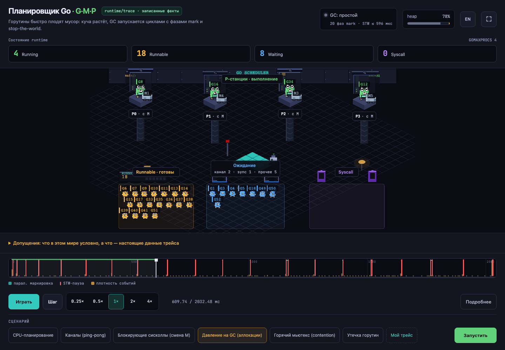

# Go Scheduler Live — the Go runtime scheduler (G·M·P) and GC, visualized

**English** · [Русский](README_RUS.md)

[](https://github.com/puddiy/go-scheduler-live/actions/workflows/ci.yml)
[](https://github.com/puddiy/go-scheduler-live/actions/workflows/pages.yml)

### ▶ [Open the live demo](https://puddiy.github.io/go-scheduler-live/) — nothing to install

An educational, pixel-art visualization of the **real** Go runtime scheduler: goroutines (G) as gophers, execution slots (P) as isometric stations, OS threads (M) as numbered carriers — plus the garbage collector, allocated heap objects, CPU scheduling, blocking syscalls and stop-the-world pauses.



## The source of truth is the real runtime

This is **not a simulation**. The backend runs curated Go workloads in a subprocess under [`runtime/trace`](https://pkg.go.dev/runtime/trace), parses the binary trace with [`golang.org/x/exp/trace`](https://pkg.go.dev/golang.org/x/exp/trace), and normalizes it into a timeline the frontend replays on a virtual clock. Every event you see — goroutine state transitions, P and M bindings, mark phases, runtime STW intervals, heap metrics, block reasons — comes from a recorded Go execution. Local runs record new parameter combinations and cache repeats; the hosted demo replays recordings made in CI.

Queue membership, individual steals, runnext and parked-M lifecycle are unknown.
Runnable Gs are shown without assigning them to queues. The **Assumptions**
disclosure lists drawing limits, time scaling and omitted internals. Initial
states and partial ranges are preserved without inventing their start times.
See the [fidelity audit](docs/fidelity-audit.md).
The [Superdesign workflow](docs/superdesign.md) documents the canvas and local UI context.

## Features

- **G/M/P inspector** — click a resource or use the keyboard picker to see its observed state, bindings and recent normalized trace events. M shows its real ThreadID; syscall origin P is distinct from current ownership. Back/Step navigate complete timestamp groups.

- **Six curated scenarios** — CPU scheduling, channel ping-pong, GC pressure, blocking syscalls (recorded P handoff), hot mutex contention, goroutine leak — each traced live with your `GOMAXPROCS` and goroutine count.
- **Real OS threads (M).** The trace carries the executing thread id on every event; carriers dock at P stations and leave with their goroutine into blocking syscalls. P release and acquisition are shown separately without inferring the initiator.
- **Real GC.** A to-scale GC strip (concurrent-mark bands + STW ticks), heap bar for allocated objects / soft GC goal, including ratios above 100%, and an STW flash that reports the honest pause duration (microseconds, not the stretched animation).
- **Event log with causality** — every trace event with who-woke-whom, wait/run/syscall durations, lower bounds for initial states and syscall-to-Runnable transitions, derived strictly from trace facts.
- **floor796-style zoom & pan** — wheel to zoom up to 6×, goroutine id tags re-rasterize and stay crisp.
- **RU/EN interface** — a header toggle switches the whole UI, including captions and the event log.
- **Shareable URLs** — scenario, parameters and the paused playhead moment encode into the address bar.
- **Static demo mode** — a baked matrix of traces deploys to GitHub Pages with no backend at all. The hosted demo has no Go behind it, so its controls select the nearest pre-baked run (GOMAXPROCS 1/4/8 per scenario) instead of recording a new trace; the page says so, and running locally records for real.

## Scenarios

| Scenario | What it teaches |
|---|---|
| CPU scheduling | Runnable Gs execute across Ps; ordinary trace does not identify individual steals |
| Channels (ping-pong) | A ring of goroutines passes tokens; most wait on `chan receive` |
| GC pressure | Fast allocation drives GC cycles: concurrent mark + stop-the-world |
| Blocking syscalls ¹ | Blocking read on M; recorded P release and acquisition by another M |
| Hot mutex | One `sync.Mutex` serializes N workers no matter how many Ps exist |
| Goroutine leak | Goroutines block forever on a channel nobody writes to; Waiting only grows |

¹ Unix only — it needs a genuinely blocking `syscall.Read` on a raw fd. On Windows five scenarios register instead of six.

## How it works

```
cmd/workload (subprocess, runtime/trace on stdout)
      │  binary trace
      ▼
internal/tracerun  ──►  internal/traceparse  ──►  internal/timeline   ──►  internal/api
   run → bytes           x/exp/trace → events      domain model/DTO         HTTP/JSON
                                                                              │
                                                              web/ (Vite + TypeScript + PixiJS)
                                                    player/ (pure stateAt(t) + virtual clock)
                                                    scene/  (isometric pixel world, zoom/pan)
                                                    ui/     (DOM chrome, event log, i18n)
```

- The trace is captured in a **separate subprocess** — the server's own goroutines never pollute it, and `GOMAXPROCS` is set per run.
- Scenarios pace themselves with CPU work (`busyFor`), never `time.Sleep` — sleeping parks goroutines and empties the world; unpaced channel scenarios generate millions of events.
- Pure logic (state folding, GC summary, layout, causality log, viewport math, i18n) is unit-tested; the visual layer is verified by Playwright harnesses, including a 38-point control contract.

For package boundaries, the `mid` binding rules, what is real versus reconstructed, and the traps that shaped the design, see **[docs/architecture.md](docs/architecture.md)**.

## Quick start

Prerequisites: **Go 1.25+**, **Node 22.12+ or 24+**.

```bash
# backend (terminal 1)
go run ./cmd/server

# frontend (terminal 2)
cd web
npm install
npm run dev
```

Open http://localhost:5173. A new parameter combination records a trace; repeating it replays the in-memory cache.

If :8080 is already taken on your machine, move the backend and point the dev proxy at it: `go run ./cmd/server -addr :8085` with `GMP_API_TARGET=http://localhost:8085 npm run dev`.

### Static build (no backend)

```bash
go run ./cmd/bake                 # bakes web/public/runs/*.json
cd web
VITE_STATIC=1 npm run build       # frontend serves the baked matrix
npx vite preview
```

The same pipeline deploys to GitHub Pages on every push to `main` (`.github/workflows/pages.yml`).

## Testing

```bash
go test ./...                     # scheduler invariants incl. M bindings, scenario anti-regressions
cd web && npx vitest run          # pure logic: state, GC, layout, causality, share codec, viewport, i18n
node scripts/verify-controls.mjs  # Playwright: 38-point control contract (needs both servers running)
node scripts/verify-inspector.mjs # Playwright: resource selection, event history, keyboard and responsive inspector
```

> The backend compiles and runs the workload on demand (`go run`), so it needs the Go toolchain and this module's source at runtime. It is a local teaching tool — **do not expose the dev server publicly.**

## Honesty notes

The **Assumptions** disclosure is the authoritative list. Queue internals and
steals remain unknown; render caps limit sprites, never counts. GOMAXPROCS comes
from its recorded metric. STW intervals include stopping/restarting coordination
and do not force every G into a frozen pose. Mark counts include complete phases
only. Heap metrics are downsampled, and the heap goal is soft. Decorative poses,
factory scenery and the 90-second playback scale are explained in the UI.

## Contributing

The architecture was cut so that three kinds of contribution are cheap to write
and cheap to review:

- **A scenario** — one file in `internal/scenarios/`, a `Register` call, a test.
  The most self-contained way to add something that teaches.
- **A language** — one dictionary in `web/src/i18n.ts`, with the compiler
  checking your work: a missing string fails `tsc` rather than shipping blank.
- **A fidelity report** — "the world shows X, the runtime does Y". No code
  required, and the highest priority of anything here.

[CONTRIBUTING.md](CONTRIBUTING.md) has the details, including the two traps that
bite every new scenario. Also: [Code of Conduct](CODE_OF_CONDUCT.md),
[security policy](SECURITY.md) — read that one before hosting the backend
anywhere.

## Roadmap

**Next** — more scenarios (context cancellation, a bounded worker pool, atomics
versus a mutex); prebuilding the workload binary instead of `go run` per request;
something that shows a blocking syscall on Windows, where the current scenario
cannot run.

**Maybe** — additional trace-backed runtime measurements, including
background mark workers’ CPU usage; extracting the trace → Timeline
pipeline as a library other tools could use.

**Not planned** — a public instance that records live traces. See the
[security policy](SECURITY.md) for why.

## How this was built

Developed in pair with [Claude Code](https://claude.com/claude-code). Every claim this project makes about the runtime is held to a trace and a test: `go test ./...` asserts scheduler invariants against the raw trace on every scenario, and anything that could not be derived from trace facts is listed in the Assumptions panel rather than quietly drawn.

## Credits

- The Go gopher was designed by [Renée French](https://reneefrench.blogspot.com/) and is licensed under [CC BY 3.0](https://creativecommons.org/licenses/by/3.0/). The sprites here are an original pixel-art interpretation drawn procedurally in code; no official artwork is redistributed.
- Fonts: [Pixelify Sans](https://fonts.google.com/specimen/Pixelify+Sans) and [JetBrains Mono](https://www.jetbrains.com/lp/mono/), both under the SIL Open Font License.
- The isometric presentation and the zoom/pan feel are inspired by [floor796](https://floor796.com/).
- Go and the Go gopher are trademarks of Google LLC. This project is independent and not affiliated with or endorsed by Google.

## License

[Apache License 2.0](LICENSE).
